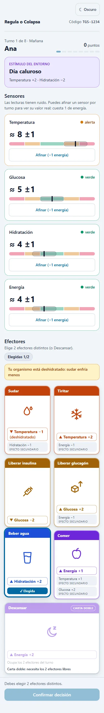
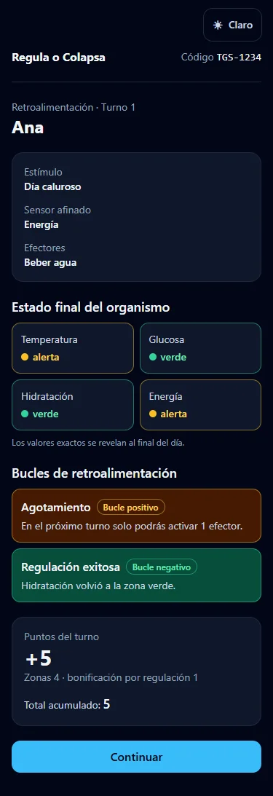

# Regula o Colapsa

Juego educativo web para el parcial de **Teoría General de Sistemas (TGS)**. Eres el centro de control de un organismo humano y debes mantener cuatro variables fisiológicas —temperatura, glucosa, hidratación y energía— en homeostasis durante un día de 8 turnos, con información incompleta y bucles de retroalimentación que pueden jugar a tu favor o en tu contra.

Se juega desde el navegador del celular (iPhone o Android) o del computador, en solitario o de 2 a 4 jugadores por turnos en un mismo dispositivo. No requiere servidor ni cuenta, y funciona sin conexión después de la primera visita.

**▶ Jugar:** https://navier0615.github.io/regula-o-colapsa/

<p align="center">
  
</p>

El QR en alta resolución, listo para imprimir, está en [`docs/qr-regula-o-colapsa.png`](docs/qr-regula-o-colapsa.png).

<p align="center">
  
  
</p>

## Temas de TGS integrados

| Tema | Cómo aparece en el juego |
| --- | --- |
| **Cibernética** | El jugador es el controlador de un sistema con punto de ajuste (5): percibe con sensores, decide y actúa con efectores para corregir desviaciones. |
| **TGS en sistemas biológicos** | El organismo es un sistema abierto: el entorno lo perturba (calor, ayuno, infección…) y las variables están acopladas (sudar enfría pero deshidrata). |
| **Retroalimentación** | Bucles **negativos** (regular una variable de vuelta a la zona verde) y **positivos** que amplifican el desequilibrio (fiebre, hipoglucemia, deshidratación, agotamiento). |
| **Teoría de la decisión** | Cada turno se eligen 2 efectores entre 7 con costos y efectos secundarios, bajo restricciones y con información incierta. |
| **Entropía en la información** | Los sensores tienen ruido (±1 y luego ±2): el jugador ve lecturas, no valores reales. Puede *afinar* un sensor pagando energía para reducir la incertidumbre. |

## Cómo jugar (resumen)

1. **Estímulo del entorno.** El entorno perturba tu organismo. Todos los jugadores reciben los mismos 8 estímulos, cada uno en distinto orden.
2. **Lectura de sensores.** Ves lecturas con ruido (“≈ 7 ±1”). Una vez por turno puedes afinar un sensor (“= 7 real”) a cambio de 1 de energía.
3. **Decisión.** Elige 2 cartas de efector distintas (o Descansar, que ocupa las dos). Con agotamiento solo puedes activar 1; con deshidratación, sudar enfría menos.
4. **Retroalimentación del sistema.** Se aplican los efectores y los bucles; ves en qué zona quedó cada variable, sin su valor exacto.
5. **Puntuación del turno.** Verde +2, alerta 0, crisis −2, y +1 por cada variable que regulaste de vuelta a la zona verde.

Si alguna variable termina en 0 o 10, el organismo **colapsa**. En solitario ganas con 40 puntos o más sin colapsar; en multijugador gana el mayor puntaje. Al final del día se revelan los valores reales en una gráfica por jugador. Las instrucciones completas están dentro del juego.

## Stack

- **TypeScript** (modo strict) + **React** + **Vite**
- **Zustand** con `persist` (la partida se guarda en el navegador)
- **React Router** con `HashRouter`
- **Tailwind CSS** con tokens de color para tema claro y oscuro (contraste WCAG verificado)
- **Recharts** para la gráfica de evolución
- **vite-plugin-pwa**: instalable y con funcionamiento sin conexión
- **Vitest** + **React Testing Library**
- **GitHub Actions** + **GitHub Pages** para el despliegue

## Arquitectura en capas

```
src/
  domain/      Motor del juego: TypeScript puro, sin React. Funciones puras e inmutables.
    config/    Todos los números del juego como datos (sin "números mágicos" en la lógica).
    engine/    Estímulos, sensores, decisión, retroalimentación, puntuación, colapso y
               la máquina de estados de la partida. PRNG con semilla: el mismo código
               (TGS-XXXX) reproduce la misma partida en cualquier dispositivo.
  state/       Store de Zustand: solo orquesta llamando al dominio. Los selectores
               exponen a la interfaz únicamente lo que la fase actual permite ver.
  pages/       Inicio, instrucciones y partida (rutas #/, #/instrucciones, #/partida).
  features/    Pantallas de la partida: turno, retroalimentación y resultados.
  ui/          Componentes de presentación (medidores, cartas, gráfica, ranking…).
tests/         Pruebas del motor, del store y de la interfaz.
```

La interfaz nunca contiene reglas del juego: lee el estado y dispara acciones. Las reglas, que son la fuente de verdad, están documentadas en [`CLAUDE.md`](CLAUDE.md).

## Comandos

Requiere Node.js 22 o superior.

```bash
npm install          # instalar dependencias
npm run dev          # servidor de desarrollo (http://localhost:5173/regula-o-colapsa/)
npm run test         # pruebas (Vitest)
npm run lint         # lint (oxlint)
npm run build        # compilación de producción en dist/
npm run preview      # servir dist/ localmente
npm run qr           # regenerar docs/qr-regula-o-colapsa.png
```

### Despliegue

Cada push a `main` ejecuta el workflow [`.github/workflows/deploy.yml`](.github/workflows/deploy.yml): instala dependencias, corre pruebas, lint y build, y publica `dist/` en GitHub Pages. También puede lanzarse a mano desde la pestaña *Actions* (`workflow_dispatch`) o con:

```bash
gh workflow run deploy.yml
```

La app se publica bajo `/regula-o-colapsa/` (`base` en `vite.config.ts`). Si el repositorio cambia de nombre, hay que actualizar ese valor y la URL de `scripts/generar-qr.mjs`.

## Capturas

En [`docs/capturas/`](docs/capturas/) hay capturas de todas las pantallas en 375, 768 y 1280 px, en tema claro y oscuro.
